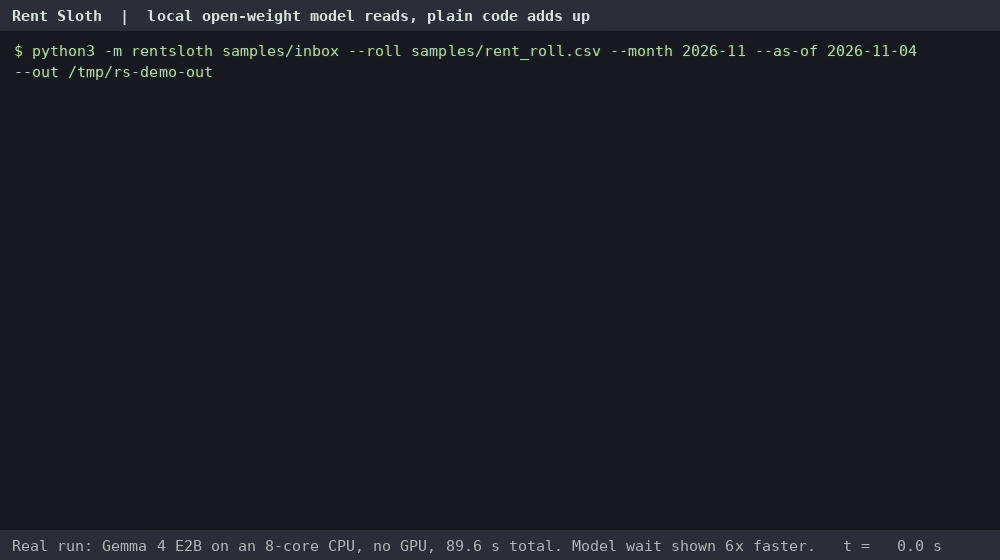

# Rent Sloth 🦥

**Drop your rent payment notifications in a folder. Wake up to a two-line rent summary.**
An open-weight model (Gemma 4 E2B, 2.8 GB, a CPU is enough) *reads* each Zelle, Venmo, Cash App, PayPal, Apple Cash or bank alert. Plain, tested code checks every reading, matches it to your rent roll and does the sums.
Nothing leaves your machine: tenant names, amounts and bank alerts stay local.



```
November 2026 rent: 4 of 6 units paid in full, $6,350.00 of $8,400.00 collected.
Short: 2B Priya Nair $650.00. Not yet: 3B Tom Becker (late after Nov 6). Check 2 payments: $300.00 (no payer named) on Nov 4, $85.00 from J Rivera on Nov 3.
```

## What it does

Small landlords get paid through four or five apps plus the bank, by tenants who split rent, pay early, pay twice, or send "other half" with no name on it. Rent Sloth reads a folder of those notifications (`.txt` or `.eml`) and writes:

- **`summary.txt`**: two lines. Who's paid, who's short and by how much, who isn't late *yet* (with the date they become late), and which payments it couldn't place.
- **`ledger.csv`**: one row per counted payment (date, unit, payer, amount, memo, reference, how it was matched).
- **`audit.md`**: every field the model read, marked `ok`, `FIXED` (a rule corrected it) or `CHECK` (a human should look), plus every message it didn't count and why: a payment request, an ad, a payment *you* sent, a duplicate alert, or a payment for another month.

## How it works (the model only reads)

1. **Read.** Each message goes to a local OpenAI-compatible server (tested with llama.cpp's `llama-server`, build b11617). The reply is forced into a JSON Schema: the kind of message, payer, amount, date, memo and reference, each with the exact words it was copied from.
2. **Check with rules, not another model.** Quotes must appear in the message. The amount must appear in its quote. Dates are re-read from the quote (or the message's own `Date:` header). Wording rules overrule the model on the kind of message ("You sent", "You paid", "You requested" are never money received). A payer that is really the bank or the app that sent the alert is replaced by the person the message names ("Devon Price paid you"), or left blank and flagged.
3. **Match and add up, in plain Python.** A payment matches a unit by tenant name (also "Samuel" for "Sam", and bank-style "ALVAREZ, BETH M") or by a unit number in the memo. If the name and the memo disagree, it goes to `CHECK` rather than guessing. Duplicate alerts are dropped by reference number. Payments dated more than 10 days before the due date (or after the month ends) are not counted for this month. Each unit is Paid, Paid (over), Partial (short), Not yet, or Late after its grace period.

## Measured accuracy (Gemma 4 E2B Q4_0, temperature 0)

The sample notifications are synthetic: we wrote them to look like real alerts, with a hand-made answer key (`samples/truth.json`). We score `kind` for every message, plus payer, amount and date for money received.

| Set | Fields | Model alone | After rule checks | Wrong and **not** flagged | Payments placed right | Unit statuses right |
|---|---:|---:|---:|---:|---:|---:|
| Dev set (13 messages; rules were written on these) | 43 | 39 | 42 (1 more flagged `CHECK`) | 0 | 13/13 | 6/6 |
| Held-out (8 messages, written after the rules were frozen; hashes in `eval/frozen_rules.sha256`, which no longer match because of the fix below), first run | 23 | 20 | 22 | **1** | 7/8 | 3/4 |
| Same held-out messages after fixing what that run found | 23 | 20 | 23 | 0 | 8/8 | 4/4 |

What the model got wrong on its own (7 of 66 fields): it named the alert's sender as the payer 5 times (Venmo, First Prairie Bank twice, Apple, and a bank-style "ALVAREZ, BETH M"), and called "You sent $200.00 to Luis Romero" and "You paid Grace Kim $35.00" money *received*. Every amount and every date it read was right. The wording rules fixed the kind of message both times, which matters most: counting a refund you sent as rent received is the expensive mistake.

The held-out run found one real hole: a bank alert listing the payer as "ALVAREZ, BETH M" didn't match tenant Beth Alvarez, so a paid unit showed as Not yet (with the $990 listed under "Check"). It's fixed and is now two tests. Because the rules were then changed on those same messages, the last row is no longer a clean held-out number. Treat it as an honest small-sample result, not a benchmark. Recorded model replies are in `tests/fixtures/` and CI re-scores them on every push.

Speed on an 8-core CPU with no GPU: about 7 s per message (13 messages in 96 s, 8 in 58 s).

## Quick start

Python 3.9+ (standard library only) and any local OpenAI-compatible server that supports `response_format` JSON Schema.

```bash
# 1. a local model server (llama.cpp release binaries: https://github.com/ggml-org/llama.cpp/releases)
llama-server -m gemma-4-E2B-it-Q4_0.gguf --port 8080 --jinja      # model: huggingface.co/ggml-org/gemma-4-E2B-it-GGUF
# 2. point it at a folder of notifications and your rent roll
git clone https://github.com/onyxaholguin-cyber/rent-sloth && cd rent-sloth
python3 -m rentsloth samples/inbox --roll samples/rent_roll.csv --month 2026-11 --as-of 2026-11-04 --out rent-sloth-out
# no model handy? replay the recorded Gemma replies:
python3 -m rentsloth samples/inbox --roll samples/rent_roll.csv --month 2026-11 --as-of 2026-11-04 --from-json tests/fixtures/gemma-4-E2B-it-Q4_0
```

The rent roll is a CSV: `unit,tenants,rent,due_day,grace_days`, with roommates separated by `;`. Save alerts into the folder however you like (a mail rule that saves messages, or copy-paste). To get the summary every morning, run it overnight with cron:

```
30 5 * * * cd ~/rent-sloth && python3 -m rentsloth ~/rent-inbox --roll ~/rent_roll.csv --month $(date +\%Y-\%m) --out ~/rent-sloth-out
```

`--server` / `RENT_SLOTH_SERVER` points at another server; `--record DIR` saves the model's replies so you can re-run the rules without the model. Exit code 1 means at least one payment needs a human look.

## Limits

- One month at a time, rent only (no late fees or utilities). Partial payments are totals, not a payment plan.
- Only plain text. For HTML emails, save them as text first.
- The model is small and the test set is small (21 messages). Read the `CHECK` lines; that's what they're for.
- Not accounting or legal advice.

## Credits

- [Gemma 4](https://ai.google.dev/gemma) (open weights, Google) via [ggml-org/gemma-4-E2B-it-GGUF](https://huggingface.co/ggml-org/gemma-4-E2B-it-GGUF).
- [llama.cpp](https://github.com/ggml-org/llama.cpp) `llama-server` (MIT) for local inference and JSON Schema-constrained output.
- Built by Sheet & Flow during the DEV Hacktoberfest Open-Source AI Challenge, Week 3 (Oct 19–25, 2026), with an AI coding agent. The quote-then-verify pattern comes from our earlier [Lease Lens](https://github.com/onyxaholguin-cyber/lease-lens); all code here is new.

MIT licensed.
